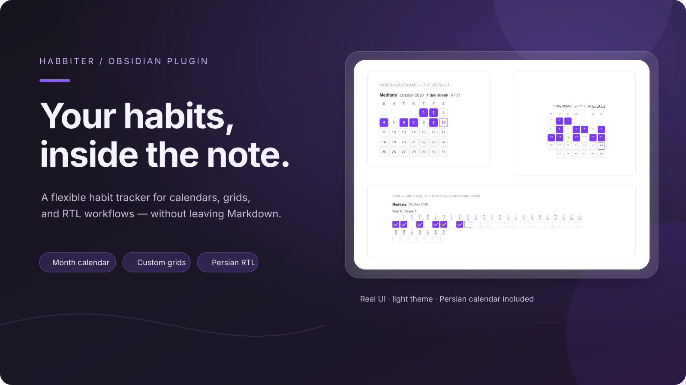
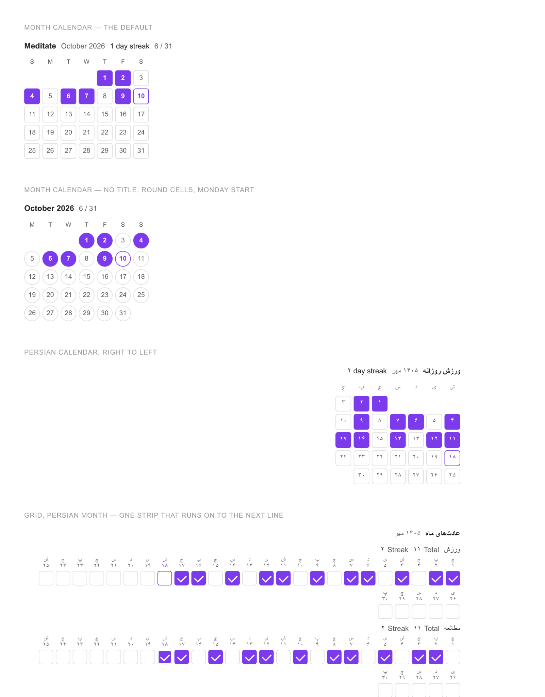
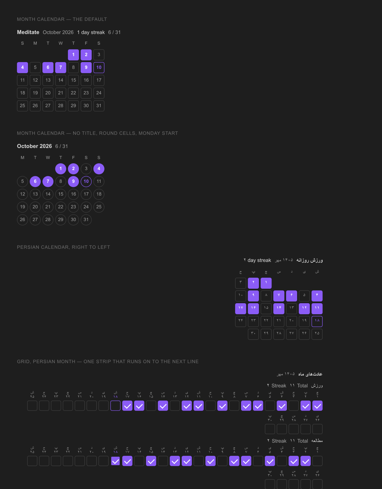
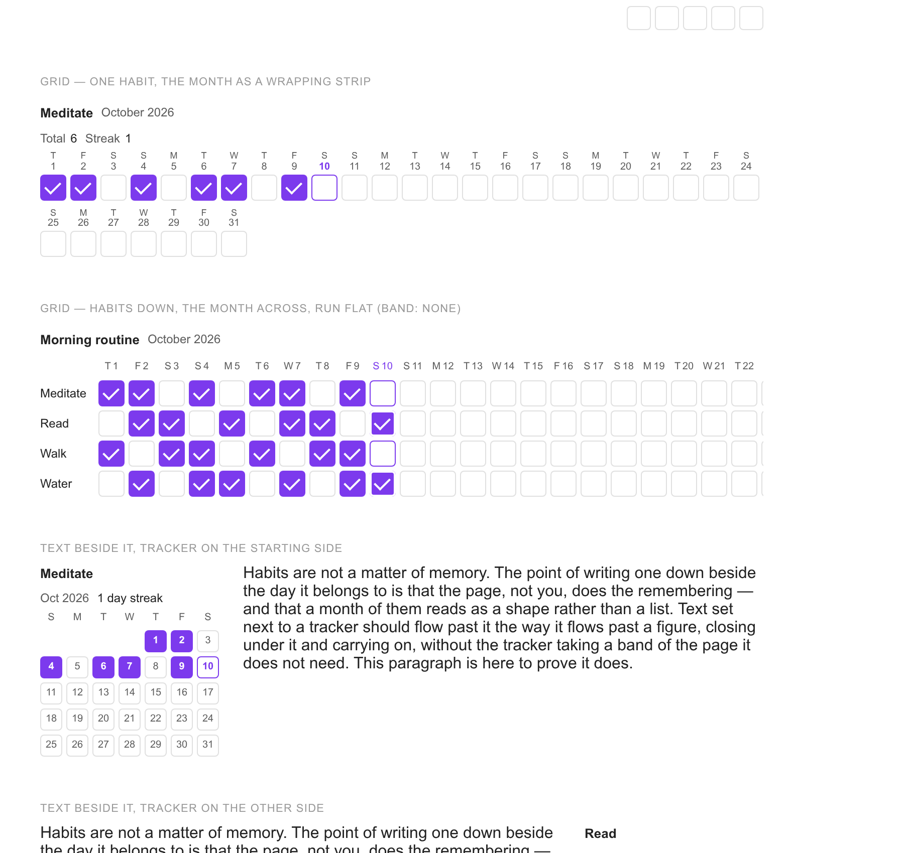

<div align="center">

# Habbiter

**ردیاب عادت‌ها و جدول‌های سفارشی، مستقیماً درون یادداشت‌های Obsidian.**

[](https://obsidian.md/plugins)
[](https://github.com/Ali-Nourix/Habbiter/releases/latest)
[](LICENSE)
[](https://github.com/Ali-Nourix/Habbiter/actions/workflows/ci.yml)

Habbiter یک بلوک کد حصاردار را به ردیاب عادت تعاملی تبدیل می‌کند که بخشی از یادداشت Markdown شما باقی می‌ماند. برای عادت‌های روزانه از تقویم استفاده کنید یا شبکه‌ای سفارشی از چک‌باکس‌ها و شمارنده‌ها بسازید؛ بدون افزودن داشبوردی جداگانه یا تغییر ظاهر خزانهٔ یادداشت‌هایتان.

[English](README.md) · [نصب](#نصب) · [نمونه‌ها](#ساخت-ردیاب) · [توسعه](#ساخت-و-آزمایش)

[**نصب**](#نصب) · [**نمونه‌ها**](#ساخت-ردیاب) · [**قابلیت‌ها**](#گزینههای-بلوک) · [**توسعه**](#ساخت-و-آزمایش)

</div>

## در عمل ببینید

<p align="center">
  
</p>

<p align="center">
  
  
</p>

<p align="center">
  
</p>

تصاویر این گالری از رندرکنندهٔ واقعی ردیاب در محیط پیش‌نمایش استفاده می‌کنند. متن رابط فارسی با فونت **Vazirmatn** نمایش داده می‌شود.

---

## نصب

تا زمانی که افزونه به فهرست افزونه‌های انجمن اضافه نشده است، فایل‌های `main.js`، `manifest.json` و `styles.css` را از این مخزن در مسیر `<vault>/.obsidian/plugins/habbiter/` کپی کنید و سپس از بخش **Settings → Community plugins** آن را فعال کنید. فایل ساخته‌شدهٔ `main.js` در مخزن قرار دارد؛ بنابراین برای نصب نیازی نیست ابتدا چیزی بسازید.

## ساخت ردیاب

در ویرایشگر راست‌کلیک کنید و **Insert habit tracker…** را انتخاب کنید، یا فرمان **Habbiter: Insert tracker** را از پالت فرمان اجرا کنید.

در هر دو حالت، فرمی باز می‌شود که پیش‌نمایش زندهٔ ردیاب در بالای آن قرار دارد. این پیش‌نمایش تصویر ثابت نیست؛ همان مؤلفهٔ واقعی است و می‌توانید پیش از ثبت، در آن کلیک کنید. کلیک‌های انجام‌شده در پیش‌نمایش ذخیره نمی‌شوند.

فرم یک بلوک کد حصاردار در یادداشت می‌نویسد؛ همین بلوک تنها چیزی است که وارد فایل Markdown می‌شود:

````markdown
```habbiter
id: hb-m8x2q1a4
title: مدیتیشن
```
````

برای ویرایش بعدی، نشانگر را روی ردیاب ببرید و **⋯ → Edit tracker…** را انتخاب کنید. همان فرم، این بار با مقادیر موجود، باز می‌شود. اگر نام ردیف یا ستون را در فرم تغییر دهید، تیک‌های قبلی حفظ می‌شوند؛ فرم فهرست قدیمی را بر اساس موقعیت هر مورد با فهرست جدید تطبیق می‌دهد.

## گزینه‌های بلوک

همهٔ گزینه‌ها به‌جز `id` اختیاری‌اند. هر گزینه‌ای که مشخص نکنید از مسیر **Settings → Habbiter** پیروی می‌کند؛ بنابراین هر بلوک فقط تنظیماتی را بیان می‌کند که خودتان انتخاب کرده‌اید.

| کلید | کاربرد |
| --- | --- |
| `id` | محل ذخیرهٔ تیک‌ها. این شناسه برای شما نوشته می‌شود؛ آن را برای ردیاب دیگری دوباره استفاده نکنید. |
| `title` | نام ردیاب. اگر تقویم ماهانه عنوان نداشته باشد، نام ماه به‌عنوان عنوان آن استفاده می‌شود. |
| `mode` | `month` — ماه به‌شکل تقویم؛ `grid` — ردیف‌ها و ستون‌ها. |
| `cell` | `check` برای چک‌باکس و `count` برای شمارنده. |
| `goal` | فقط برای شمارنده: مقدار هدفی که یک خانهٔ کامل نشان می‌دهد. با کلیک، مقدار تا هدف افزایش می‌یابد و سپس دوباره به صفر برمی‌گردد. |
| `rows` | فقط برای شبکه: فهرست نام ردیف‌ها. |
| `columns` | فقط برای شبکه: فهرست نام‌ها، یک عدد ساده یا `days` برای روزهای ماه. |
| `band` | برای ستون‌های روز: `wrap` روزهای ماه را به خط بعد می‌برد؛ `week` ماه را بر اساس هفته‌ها می‌شکند؛ `none` همهٔ روزها را در یک خط قابل پیمایش نگه می‌دارد. |
| `calendar` | `gregorian` یا `persian`. |
| `month` | `current` یا سال و ماه در تقویم خود بلوک، مانند `2026-09`. |
| `weekStart` | `auto`، نام یک روز هفته یا عدد `0` تا `6` که در آن `0` به معنی یکشنبه است. |
| `locale` | برچسبی مانند `fa` یا `en-GB` برای نام ماه‌ها و روزهای هفته. مقدار خالی از زبان برنامه پیروی می‌کند. |
| `numerals` | `locale` یا `latin`. |
| `dayNumbers`، `weekdays`، `totals`، `streak` | تعیین می‌کنند ردیاب کدام اطلاعات را نمایش دهد. |
| `size` | اندازهٔ هر خانه بر حسب پیکسل، از ۲۰ تا ۴۴. |
| `wrap` | `none` برای قرارگرفتن در یک ردیف مستقل، یا `start` / `end` برای قرارگرفتن متن در کنار آن. مقادیر `left` و `right` نیز پذیرفته می‌شوند و همان معنا را دارند. |
| `trackers` | فهرستی از چند ردیاب برای قرار دادن در یک بلوک؛ توضیحات پایین را ببینید. |
| `layout` | برای چند ردیاب در یک بلوک: `row` برای قرارگیری کنار هم یا `deck` برای چیدن روی هم به‌شکل دسته‌ای از کارت‌ها. |

### تقویمی که در عرض صفحه جا می‌شود

شبکه‌ای که برای هر روز یک ستون دارد، ۳۱ ستون خواهد داشت؛ عرض هیچ یادداشتی آن‌قدر زیاد نیست. در حالت تخت، انتهای شبکه به نوار پیمایش افقی می‌رسد و ردیابی که برای دیدنش باید پیمایش کرد، دیگر با یک نگاه بررسی نمی‌شود. به همین دلیل، روزهای ماه به خط بعد می‌روند و شبکه از هر عرضی که یادداشت در اختیارش بگذارد استفاده می‌کند:

```
مدیتیشن   مجموع ۱۸   تداوم ۳
 ش  ی  د  س  چ  پ  ج  ش  ی  د  س  چ  پ  ج  ش  ی  د  س
 ۱  ۲  ۳  ۴  ۵  ۶  ۷  ۸  ۹ ۱۰ ۱۱ ۱۲ ۱۳ ۱۴ ۱۵ ۱۶ ۱۷ ۱۸
 ■  ■  □  ■  □  ■  ■  □  ■  ■  □  ■  □  ■  ■  □  ■  ■
۱۹ ۲۰ ۲۱ ۲۲ ۲۳ ۲۴ ۲۵ ۲۶ ۲۷ ۲۸ ۲۹ ۳۰
 □  ■  ■  □  ■  □  ■  ■  □  ■  ■  □
```

هر روز تاریخ خودش را در همان خانه‌ای دارد که همراه آن به خط بعد می‌رود. اگر یک ردیف تاریخ و یک ردیف خانه‌ها جداگانه بشکنند، از نخستین شکست خط دیگر با هم تطبیق نخواهند داشت.

گزینهٔ `band: week` ماه را بر اساس هفته‌ها می‌شکند. این حالت ستون‌ها را در امتداد صفحه مرتب می‌کند و اجازه می‌دهد نام روزهای هفته فقط یک بار نوشته شود. برای چند عادت هم‌زمان کاربردی است؛ جایی که خود تقویم به‌تنهایی کافی نیست. برای یک عادت، صرفاً شکل دیگری از نمایش تقویم است. گزینهٔ `band: none` همهٔ روزها را در یک خط قابل پیمایش نگه می‌دارد.

نمونهٔ شبکه‌ای با چند عادت در طول ماه:

````markdown
```habbiter
id: hb-k1p7w2
title: برنامهٔ صبحگاهی
mode: grid
rows:
  - مدیتیشن
  - مطالعه
  - پیاده‌روی
columns: days
totals: true
```
````

نمونهٔ شمارنده‌ها برای یک هفته:

````markdown
```habbiter
id: hb-r4t9m0
title: تکرارها
mode: grid
cell: count
goal: 4
rows: [شنا، اسکوات، پلانک]
columns: [دوشنبه، سه‌شنبه، چهارشنبه، پنجشنبه، جمعه]
```
````

## نوشتن متن در کنار ردیاب

یک بلوک می‌تواند علاوه بر ردیاب، متن هم داشته باشد و این دو در کنار یکدیگر قرار بگیرند:

````markdown
```habbiter
id: hb-n3f8
title: مدیتیشن
size: 22
side: start
text: |
  ده دقیقه، **پیش از** قهوه.

  برای ادامهٔ برنامه [[روال صبحگاهی]] را ببینید.
```
````

متن، Markdown معمولی است و Obsidian آن را رندر می‌کند؛ پیوندها، قالب‌بندی و محتوای جاسازی‌شده همگی کار می‌کنند و با فونت و اندازهٔ متن خود یادداشت نمایش داده می‌شوند. مقدار `side: start` ردیاب را در ابتدای خط قرار می‌دهد (در انگلیسی سمت چپ و در فارسی سمت راست) و `side: end` آن را در سمت مقابل قرار می‌دهد.

«کنار هم» در تمام عرض‌ها به معنی کنار هم باقی ماندن است. شبکهٔ ردیاب حداقل عرض مشخصی دارد؛ بنابراین هنگام باریک شدن پنل، ستون متن باریک‌تر می‌شود و به زیر ردیاب منتقل نمی‌شود.

ساده‌ترین روش نوشتن این ساختار استفاده از سازنده است: در **⋯ → Edit tracker…** کادر **Text beside it** را همراه با پیش‌نمایش زنده می‌بینید. منوی **⋯** روی خود ردیاب نیز بدون باز کردن فرم، جای دو بخش را عوض می‌کند.

**چرا متن داخل بلوک قرار دارد؟** روش بدیهی این است که بلوک شناور شود تا پاراگراف‌های یادداشت از کنارش عبور کنند؛ اما این روش در Live Preview درست کار نمی‌کند. بلوک شناور از جریان خط CodeMirror که آن را در خود نگه داشته خارج می‌شود، خط خالی اندازه‌گیری می‌شود و ویرایشگر به‌هم می‌ریزد. وقتی متن داخل محفظهٔ خود بلوک باشد، چیزی در ویرایشگر از هم نمی‌پاشد؛ در نتیجه چیزی که در ویرایشگر، نمای خواندن، خروجی و تلفن می‌بینید یکسان است. روش شناور در نسخهٔ 1.2.0 آزمایش شد و سپس کنار گذاشته شد.

اگر می‌خواهید ردیاب را آزادانه روی یک سطح قرار دهید، نه درون سند، از بوم Obsidian استفاده کنید؛ ردیاب مانند هر محتوای دیگری در یک کارت بوم کار می‌کند.

## چند ردیاب در کنار هم

یک بلوک می‌تواند ردیفِ چند ردیاب را در خود نگه دارد. آن‌ها در عرض یادداشت کنار هم قرار می‌گیرند و در صورت نیاز به خط بعد می‌روند؛ عرض هر ردیاب متناسب با شبکهٔ خودش است:

````markdown
```habbiter
calendar: persian
size: 22
trackers:
  - id: hb-k2p9
    title: مدیتیشن
  - id: hb-m4x1
    title: مطالعه
  - id: hb-q7v3
    title: پیاده‌روی
```
````

گزینه‌هایی که بین ردیف مشترک‌اند یک بار در ابتدای بلوک نوشته می‌شوند و همهٔ ردیاب‌ها آن‌ها را به ارث می‌برند؛ هر گزینه‌ای که برای یک ردیاب متفاوت باشد در ورودی همان ردیاب قرار می‌گیرد. هر ردیاب `id` مستقل خود را دارد و در نتیجه تیک‌های مستقل خود را حفظ می‌کند.

سریع‌ترین روش ساخت چنین ردیفی، انتخاب **⋯ → Add one beside this…** روی ردیابی است که از قبل دارید. گزینهٔ **⋯ → Take out of the row** ردیاب را از ردیف خارج می‌کند. تیک‌های آن بر اساس `id` ذخیره می‌شوند، نه جایگاه آن؛ بنابراین اگر دوباره اضافه‌اش کنید، اطلاعاتش همچنان باقی است.

**تغییر ترتیب.** از گزینه‌های **⋯ → Move earlier / Move later** روی هر ردیاب در ردیف استفاده کنید. ترتیب در خود بلوک نوشته می‌شود؛ تنها جایی که یک فایل Markdown می‌تواند چنین ترتیبی را حفظ کند. بنابراین با بستن یادداشت، همگام‌سازی و باز کردن فایل توسط فردی دیگر نیز باقی می‌ماند. کشیدن ردیاب با نشانگر امتحان شد اما کنار گذاشته شد: ردیاب در Live Preview درون CodeMirror قرار دارد و CodeMirror کنترل رویدادهای نشانگر را نیز در اختیار دارد. حرکتی که در مرورگر کار کند اما در ویرایشگر نه، از نداشتن حرکت بدتر است.

## چیدمان پشته‌ای؛ یک ردیاب در جلو

روش دیگر برای نگهداری چند ردیاب در یک بلوک، چیدن آن‌ها به‌شکل دسته‌ای از کارت‌هاست که یکی در جلو و بقیه پشت آن قرار می‌گیرند.

روی ردیاب موجود، **⋯ → Add one stacked behind this…** را انتخاب کنید. همین یک انتخاب هم ردیاب جدید را ایجاد می‌کند و هم بلوک را به حالت پشته‌ای درمی‌آورد. اگر بلوک از قبل یک ردیف داشته باشد، گزینهٔ **⋯ → Stack them, one in front** بدون افزودن ردیاب جدید، آن‌ها را به پشته تبدیل می‌کند؛ و **⋯ → Lay them out side by side** دوباره آن‌ها را کنار هم می‌چیند.

در متن بلوک، فقط یک کلید لازم است:

````markdown
```habbiter
calendar: persian
layout: deck
trackers:
  - id: hb-k2p9
    title: مدیتیشن
  - id: hb-m4x1
    title: مطالعه
  - id: hb-q7v3
    title: پیاده‌روی
```
````

کارت‌های پشته فضای مشترکی دارند؛ بنابراین اندازهٔ همهٔ کارت‌ها به‌اندازهٔ بزرگ‌ترین آن‌هاست. تمام ردیاب‌ها با یک اندازهٔ خانه رندر می‌شوند: بزرگ‌ترین اندازه‌ای که هرکدام درخواست کرده‌اند. به این ترتیب، پشته‌ای از تقویم‌ها به‌شکل کارت‌هایی هم‌اندازه نمایش داده می‌شود، نه یک کارت کوچک که در محفظه‌ای برای کارت بزرگ سرگردان باشد. اندازهٔ هر ردیاب همچنان در بلوک خودش ذخیره می‌شود؛ بنابراین هنگام قرار گرفتن در ردیف، باز شدن در سازنده یا خارج شدن از پشته، اندازهٔ اختصاصی خودش را خواهد داشت.

روی کارت جلویی به‌صورت افقی بکشید تا کارت بعدی جلو بیاید. این حرکت تنها راه نیست: پیکان‌های زیر پشته، نقطه‌های بین آن‌ها و کلیدهای ← و → روی نقطه‌ها نیز همین کار را انجام می‌دهند؛ چون نمی‌توان به حرکت نشانگر درون CodeMirror برای اجرای قابلیت تکیه کرد. لمس ساده همچنان لمس ساده باقی می‌ماند؛ کشیدن فقط وقتی آغاز می‌شود که نشانگر به‌اندازهٔ کافی حرکت کرده باشد و حرکت افقی از حرکت عمودی بیشتر باشد، تا تیک زدن خانه تصادفاً به حرکت بین کارت‌ها تبدیل نشود.

پشته حلقه‌ای است. پس از آخرین کارت، کارت اول می‌آید و پیش از کارت اول، کارت آخر؛ هیچ‌کدام از پیکان‌ها بی‌اثر نیستند. بنابراین برای رسیدن به کارت پشت کارت جلویی، کافی است یک بار به عقب بروید، نه اینکه تمام دور پشته را طی کنید. کارتی که از جلو کنار می‌رود به انتهای پشته می‌رود، نه بیرون آن.

گزینهٔ **⋯ → Move earlier / Move later** کارت را در پشته جابه‌جا می‌کند و **⋯ → Take out of the stack** آن را خارج می‌کند. فقط کارت جلویی کلیک‌ها یا کلید Tab را دریافت می‌کند؛ کارت‌های پشت آن تا وقتی جلو نیامده‌اند غیرفعال‌اند.

**چه چیزی پشتیبانی نمی‌شود؟** کشیدن ردیاب به نقطه‌ای دلخواه روی صفحه. یادداشت یک سند Markdown است، نه بوم؛ جایی برای ثبت اینکه یک عنصر مثلاً ۲۴۰ پیکسل از سمت چپ فاصله دارد وجود ندارد و هر راهکار ساختگی در نمای خواندن، خروجی و تلفن از هم می‌پاشد. برای جای‌گذاری آزاد از بوم خود Obsidian استفاده کنید؛ ردیاب درون کارت بوم کار می‌کند.

## استفاده از ردیاب

| کلید یا عمل | نتیجه |
| --- | --- |
| کلیک | خانه را علامت می‌زند یا شمارنده را یک واحد افزایش می‌دهد؛ در صورت رسیدن به هدف، دوباره به صفر برمی‌گردد. |
| Shift و کلیک | شمارنده را یک واحد کاهش می‌دهد. |
| کلیدهای جهت‌دار | حرکت در شبکه. |
| Space یا Enter | همان عملکرد کلیک. |
| `+` و `-` | افزایش یا کاهش شمارنده، حتی فراتر از هدف. |
| Backspace یا Delete | پاک کردن خانه. |
| Tab | با یک بار فشردن، ورود به شبکه یا خروج از آن. |

هر خانه یک دکمهٔ واقعی با برچسب است؛ بنابراین صفحه‌خوان عبارتی مانند «مدیتیشن — دوشنبه ۲۱ سپتامبر ۲۰۲۶» و وضعیت علامت‌خورده بودن آن را می‌خواند. روز جاری علاوه بر رنگ با یک حلقه مشخص می‌شود و خانهٔ علامت‌خورده به‌شکل سطحی یکپارچه نمایش داده می‌شود، در حالی که خانهٔ خالی فقط کادر دارد؛ بنابراین هیچ معنایی صرفاً با رنگ منتقل نمی‌شود.

## فارسی و تقویم شمسی

گزینهٔ **Calendar** را روی Persian تنظیم کنید: از تنظیمات برای کل خزانه، از سازنده برای یک ردیاب مشخص یا از مسیر **⋯ → Show in the Persian calendar** روی ردیاب جلوی شما. نام ماه‌ها به فروردین تا اسفند تغییر می‌کند، روزها در جای درست قرار می‌گیرند، نام‌ها فارسی می‌شوند، اعداد به‌شکل ۰ تا ۹ نمایش داده می‌شوند و هفته از شنبه آغاز می‌شود. تقویم زبان خودش را دارد: گزینهٔ **Language** فقط زمانی نیاز به تغییر دارد که بخواهید تقویم فارسی را با زبان دیگری نمایش دهید؛ گزینهٔ **Numerals** نیز برای نمایش اعداد به شکل 0 تا 9 است. ردیاب در یادداشت راست‌به‌چپ، خودش را نیز از راست به چپ مرتب می‌کند.

تیک‌ها همیشه بر اساس تاریخ واقعی ذخیره می‌شوند؛ بنابراین با تغییر تقویم یک ردیاب، فقط برچسب‌های شبکه عوض می‌شوند و حتی یک تیک هم از دست نمی‌رود.

## داخل کادر فراخوان

ردیاب درون کادر فراخوان، نقل‌قول یا کادر تودرتو کار می‌کند و ویرایش آن نیز به‌درستی ذخیره می‌شود. بلوک علامت `>` را در ابتدای تمام خطوط، از جمله خطوط خالی، حفظ می‌کند؛ بنابراین کادر فراخوان درست از جایی که ردیاب شروع می‌شود به پایان نمی‌رسد.

````markdown
> [!tip] صبح
>
> ```habbiter
> id: hb-abc
> title: مدیتیشن
> ```
````

این نکته مهم است، چون تا نسخهٔ 1.4.0 این قابلیت مشکل داشت. اطلاعات بخش در Obsidian به بخشی اشاره می‌کند که بلوک به آن تعلق دارد؛ داخل کادر فراخوان، آن بخش خود کادر است، نه حصار کد. در نتیجه ویرایشگر به دنبال حصار کد در جایی می‌گشت که `> [!tip]` قرار داشت، چیزی پیدا نمی‌کرد و از ذخیره خودداری می‌کرد.

## تیک‌ها کجا ذخیره می‌شوند؟

تیک‌ها در فایل دادهٔ اختصاصی افزونه، یعنی `.obsidian/plugins/habbiter/data.json`، زیر شناسهٔ هر ردیاب ذخیره می‌شوند. Obsidian Sync این اطلاعات را مانند دیگر داده‌های افزونه همگام‌سازی می‌کند.

عمداً اطلاعات به متن یادداشت بازنویسی نمی‌شوند. ذخیرهٔ مقدار در حصار کد یعنی ویرایش همان فایلی که نشانگر شما داخل آن قرار دارد؛ و هزینهٔ این کار دقیقاً زمانی نمایان می‌شود که افزونه قرار است نامحسوس باشد: نشانگری که وسط جمله می‌پرد یا تعارض همگام‌سازی میان دو دستگاه که هر دو عادت امروز را علامت زده‌اند.

پیامدهای عملی این روش را باید بدانید. کپی کردن بلوک به یادداشتی دیگر، `id` آن را نیز کپی می‌کند؛ در نتیجه هر دو جا یک ردیاب مشترک نشان می‌دهند. اگر ردیاب مستقلی می‌خواهید، برای نسخهٔ کپی‌شده `id` جدیدی تعیین کنید. حذف یادداشت، تیک‌های آن را از `data.json` حذف نمی‌کند. همچنین ردیاب در یادداشت خروجی‌گرفته‌شده یا فقط‌خواندنی همچنان نمایش داده می‌شود و کلیک می‌پذیرد، اما به‌روشنی اعلام می‌کند که تغییرات ذخیره نمی‌شوند.

## هماهنگی با پوسته

تمام چیزهایی که افزونه رسم می‌کند از متغیرها استفاده می‌کنند و هر متغیر ابتدا از توکن پوسته، سپس از توکن Obsidian و در نهایت از یک مقدار ثابت پیروی می‌کند. می‌توانید هرکدام را با یک قطعه CSS تغییر دهید:

```css
.hb-root {
  --hb-accent: var(--color-green);
  --hb-radius: 50%;
  --hb-cell: 32px;
}
```

متغیر `--hb-page` مهم‌ترین موردی است که باید بشناسید. اگر عرض ردیاب از یادداشت بیشتر شود، شبکه به‌صورت افقی زیر ستون نام ردیف‌ها پیمایش می‌شود، در حالی که آن ستون ثابت می‌ماند. پس‌زمینهٔ برچسب باید مات باشد تا خانه‌ها از پشت آن دیده نشوند. CSS نمی‌تواند رنگی را که واقعاً پشت یک عنصر رسم شده بخواند؛ بنابراین `--hb-page` رنگ پس‌زمینهٔ برچسب را تعیین می‌کند و مقدار پیش‌فرض آن رنگ صفحه است. اگر ردیاب روی سطح دیگری قرار دارد، این متغیر را متناسب با آن تنظیم کنید. پوستهٔ [Bookcloth](https://github.com/Ali-Nourix/Obsidian-Theme) این کار را برای کادرهای فراخوان، محتوای جاسازی‌شده، نوارهای کناری و پنجره‌های شناور انجام می‌دهد.

## ساخت و آزمایش

```sh
npm install
npm run build     # بررسی نوع‌ها، اجرای آزمون‌ها و سپس ساخت main.js
npm test          # محاسبات تاریخ و قالب بلوک
npm run dev       # ساخت دوباره پس از هر تغییر
```

آزمون‌ها دو بخشی را پوشش می‌دهند که اشتباه در آن‌ها پرهزینه است: محاسبات تقویمی شبکه‌ها، از جمله سال‌های کبیسهٔ تقویم فارسی، و قالب بلوک که درون یادداشت کاربر نوشته می‌شود.

پوشهٔ `preview/` مؤلفهٔ واقعی را در مرورگر و در کنار جایگزینی برای ماژول `obsidian` رندر می‌کند؛ بنابراین می‌توان تغییرات رندرکننده یا شیوه‌نامه را در هر دو پوسته، بدون نیاز به خزانهٔ Obsidian، بررسی کرد. توضیحات بیشتر در `preview/README.md` آمده است.

## انتشار نسخه

Obsidian نسخهٔ افزونه را از برچسب انتشار آن تشخیص می‌دهد؛ بنابراین خود برچسب همان شمارهٔ نسخه است و پیشوند `v` ندارد:

```sh
# فایل‌های manifest.json، package.json و versions.json را هم‌زمان به‌روزرسانی کنید، سپس:
npm run build && git commit -am "1.0.1"
git tag -a 1.0.1 -m "Habbiter 1.0.1"
git push origin main 1.0.1
```

ارسال برچسب، گردش‌کار `.github/workflows/release.yml` را اجرا می‌کند. این گردش‌کار اگر برچسب با `manifest.json` مطابقت نداشته باشد از ساخت جلوگیری می‌کند و سپس انتشاری شامل `main.js`، `manifest.json` و `styles.css` منتشر می‌کند. این فایل‌ها از طریق برچسب قابل دریافت‌اند؛ هدف اصلی ساخت همین است.

همین گردش‌کار را می‌توان از زبانهٔ Actions نیز با وارد کردن نسخه اجرا کرد؛ در این حالت خودش برچسب را از شاخه‌ای که گردش‌کار روی آن اجرا شده ایجاد می‌کند. این روش برای مواقعی است که نمی‌توان برچسب را دستی ارسال کرد. گردش‌کار نسخه‌ای را که در فایل manifest اعلام نشده باشد نمی‌پذیرد و انتشار موجودی را که فایل‌هایش از قبل پیوست شده‌اند بازنویسی نمی‌کند. اگر انتشار ناقص مانده باشد—منتشر نشده باشد یا بدون فایل پیوست منتشر شده باشد—آن را ترمیم و تکمیل می‌کند و در پایان بررسی می‌کند که هر سه فایل واقعاً روی برچسب قرار دارند.

فایل `.github/workflows/ci.yml` با هر بار ارسال تغییر اجرا می‌شود: بررسی نوع‌ها، آزمون‌ها، ساخت بسته و بررسی اینکه `main.js` ثبت‌شده در مخزن با فایلی که از کد منبع ساخته می‌شود یکسان باشد.

## مجوز

مجوز عمومی همگانی گنو، نسخهٔ ۳.۰ (GNU General Public License v3.0).
